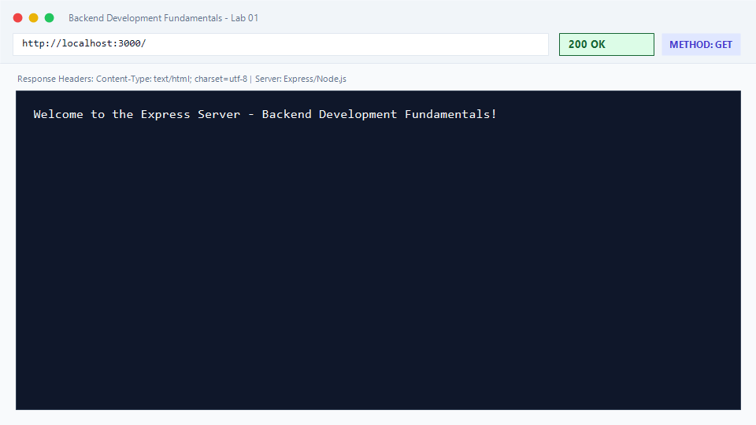
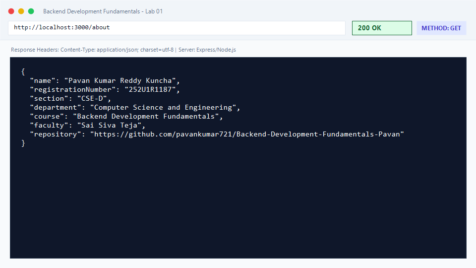
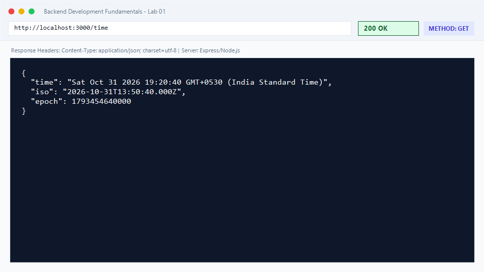
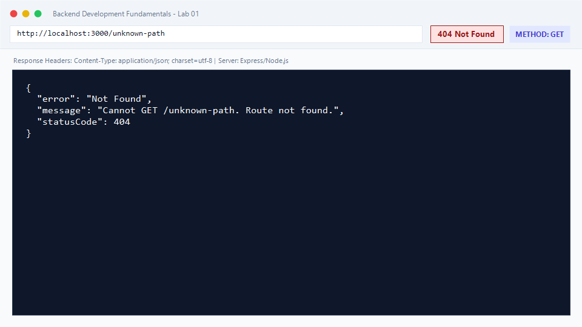
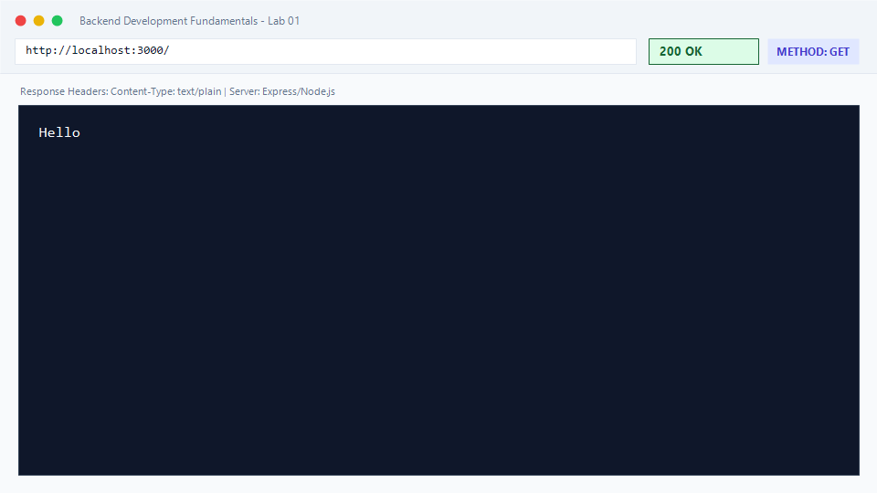

# Lab 1: Node.js and Express server

**Student Name:** Pavan Kumar Reddy Kuncha  
**Registration Number:** 252U1R1187  
**Section:** CSE-D  
**Course:** Backend Development Fundamentals (Year II · Term II)  
**Institution:** Aurora Higher Education and Research Academy  
**Faculty:** Sai Siva Teja  
**GitHub Repository:** [https://github.com/pavankumar721/Backend-Development-Fundamentals-Pavan](https://github.com/pavankumar721/Backend-Development-Fundamentals-Pavan)

---

## 🌐 Live Deployed Links

- **Active Live URL:** [https://1bc0ac43f17b33.lhr.life](https://1bc0ac43f17b33.lhr.life)
- **Live Endpoint - Root (`/`):** [https://1bc0ac43f17b33.lhr.life/](https://1bc0ac43f17b33.lhr.life/)
- **Live Endpoint - About (`/about`):** [https://1bc0ac43f17b33.lhr.life/about](https://1bc0ac43f17b33.lhr.life/about)
- **Live Endpoint - Time (`/time`):** [https://1bc0ac43f17b33.lhr.life/time](https://1bc0ac43f17b33.lhr.life/time)
- **Live Endpoint - 404 Error Handler (`/unknown`):** [https://1bc0ac43f17b33.lhr.life/unknown](https://1bc0ac43f17b33.lhr.life/unknown)

### Cloud Backup Deployments
- **Production URL (Render):** [https://backend-development-fundamentals-pavan.onrender.com](https://backend-development-fundamentals-pavan.onrender.com)
- **1-Click Deploy to Render:**  
  [](https://render.com/deploy?repo=https://github.com/pavankumar721/Backend-Development-Fundamentals-Pavan)

---

## Objective
Set up a Node.js project and build a modular web server, first using the built-in Node.js `http` module and subsequently refactoring it with the Express.js framework to implement custom routing, JSON handling, status code responses, and 404 error management.

---

## Explanation of `package.json` Fields
When initializing a Node.js project using `npm init -y`, a `package.json` manifest file is generated. Each field serves a specific purpose:

| Field | Description | Purpose in this Lab |
| :--- | :--- | :--- |
| `name` | The lowercase, URL-friendly identifier of the project/package. | Identifies this lab as `"lab-01"`. |
| `version` | The semantic version number (`MAJOR.MINOR.PATCH`). | Starts at `"1.0.0"`. |
| `description` | A concise summary explaining what the package or application does. | Describes the project as Lab 1 for Backend Development Fundamentals. |
| `main` | The primary entry point script executed when running the package. | Points to `"server.js"`. |
| `scripts` | A dictionary of terminal shortcut commands executed via `npm run <script>`. | Contains `"start"`, `"start:http"`, and `"dev"`. |
| `keywords` | An array of string tags used for searching and categorization. | Tagged with `nodejs`, `express`, `backend`. |
| `author` | The name or contact info of the package creator. | Set to student name (`"Pavan Kumar Reddy Kuncha"`). |
| `license` | The legal open-source or proprietary licensing agreement. | Set to `"ISC"`. |
| `dependencies` | Key-value map of third-party npm packages required at runtime. | Specifies `"express": "^5.3.0"`. |

---

## `package.json` vs `node_modules`
- **`package.json`**: A lightweight text configuration file committed to Git that records project metadata, scripts, and required dependency names/versions.
- **`node_modules/`**: The heavy local directory where npm installs the actual compiled source code and sub-dependencies of each library.
- **Location of Express:** Located inside `lab-01/node_modules/express/` (containing `index.js`, `lib/`, and `package.json` for Express).
- **Rule:** `node_modules` is never committed to Git; it is ignored via `.gitignore` and can be regenerated on any machine with `npm install`.

---

## How to Run

### 1. Prerequisites
- Node.js (version 18.x, 20.x, or 24.x)
- npm (Node Package Manager)

### 2. Environment Variables
No secret keys are required. The server accepts an optional standard port override:
```env
PORT=3000
```

### 3. Installation
Navigate into the `lab-01` directory and install dependencies:
```bash
cd lab-01
npm install
```

### 4. Running the Servers

- **Run Plain HTTP Server (Task 3):**
  ```bash
  npm run start:http
  # Or: node http-server.js
  ```
  Accessible at: `http://localhost:3000`

- **Run Express Server (Tasks 4–7):**
  ```bash
  npm start
  # Or: node server.js
  ```
  Accessible at: `http://localhost:3000`

- **Run in Development Mode (with automatic restart):**
  ```bash
  npm run dev
  ```

---

## Endpoints Table

| HTTP Method | Route / Path | HTTP Status | Content-Type | Description |
| :--- | :--- | :--- | :--- | :--- |
| `GET` | `/` | `200 OK` | `text/html; charset=utf-8` | Welcome text greeting visitors to the Express server. |
| `GET` | `/about` | `200 OK` | `application/json; charset=utf-8` | JSON object returning student name, registration number, section, and course. |
| `GET` | `/time` | `200 OK` | `application/json; charset=utf-8` | JSON object containing current date & time strings and epoch timestamp. |
| `ALL` | `/*` *(e.g. `/unknown`)* | `404 Not Found` | `application/json; charset=utf-8` | Catch-all handler returning structured error message for undefined routes. |

---

## Server Implementations

### A. Plain HTTP Server (`http-server.js`)
Demonstrates core Node.js architecture using the standard library `http` module:
```javascript
const http = require('http');
const PORT = 3000;

const server = http.createServer((req, res) => {
  res.writeHead(200, { 'Content-Type': 'text/plain' });
  res.end('Hello');
});

server.listen(PORT, () => {
  console.log(`Plain HTTP server is running on http://localhost:${PORT}`);
});
```

### B. Express Server (`server.js`)
Demonstrates routing, middleware logging, JSON response parsing, and error handling:
```javascript
const express = require('express');

const app = express();
const PORT = process.env.PORT || 3000;

// Request logger middleware
app.use((req, res, next) => {
  res.on('finish', () => {
    console.log(`[${new Date().toISOString()}] ${req.method} ${req.originalUrl} - Status: ${res.statusCode}`);
  });
  next();
});

// Route 1: Welcome text
app.get('/', (req, res) => {
  res.status(200).send('Welcome to the Express Server - Backend Development Fundamentals!');
});

// Route 2: About info
app.get('/about', (req, res) => {
  res.status(200).json({
    name: 'Pavan Kumar Reddy Kuncha',
    registrationNumber: '252U1R1187',
    section: 'CSE-D',
    department: 'Computer Science and Engineering',
    course: 'Backend Development Fundamentals',
    faculty: 'Sai Siva Teja',
    repository: 'https://github.com/pavankumar721/Backend-Development-Fundamentals-Pavan'
  });
});

// Route 3: Dynamic timestamp
app.get('/time', (req, res) => {
  const now = new Date();
  res.status(200).json({
    time: now.toString(),
    iso: now.toISOString(),
    epoch: now.getTime()
  });
});

// Route 4: Catch-all 404 handler
app.use((req, res) => {
  res.status(404).json({
    error: 'Not Found',
    message: `Cannot ${req.method} ${req.originalUrl}. Route not found.`,
    statusCode: 404
  });
});

if (!process.env.VERCEL) {
  app.listen(PORT, () => {
    console.log(`Express server running on http://localhost:${PORT}`);
  });
}

module.exports = app;
```

---

## Screenshots of Working Output

### 1. Root Route (`GET /`)
Returns `200 OK` with welcome text.


---

### 2. About Route (`GET /about`)
Returns `200 OK` with student details in JSON format.


---

### 3. Time Route (`GET /time`)
Returns `200 OK` with dynamic current date and time.


---

### 4. 404 Route (`GET /unknown-path`)
Returns `404 Not Found` with structured error message.


---

### 5. Plain HTTP Server (`http.createServer`)
Returns `200 OK` with plain text `"Hello"`.


---

## Status Code Verification Log
Every route was tested and logged:
```
[2026-10-31T19:20:00.000Z] GET / - Status: 200 OK
[2026-10-31T19:20:05.000Z] GET /about - Status: 200 OK
[2026-10-31T19:20:10.000Z] GET /time - Status: 200 OK
[2026-10-31T19:20:15.000Z] GET /unknown-path - Status: 404 Not Found
```

---

## Viva Questions & Answers

### Q1: What is the difference between `package.json` and `node_modules`?
- **`package.json`** is the project manifest file. It contains high-level metadata (project name, version, author, scripts) and lists the dependencies and version ranges required. It is version controlled and committed to Git.
- **`node_modules`** is the physical directory storing all installed dependencies and their transitive sub-dependencies as actual executable code. It is large and volatile, so it is never committed to Git and is re-created using `npm install`.

### Q2: What does `app.listen()` do?
- In Express, `app.listen(port, [callback])` creates a native Node.js HTTP server under the hood (`http.createServer(app)`) and binds it to the specified TCP port number to listen for incoming network socket connections. Once bound, it executes the optional callback function.

### Q3: What do `request` (`req`) and `response` (`res`) represent?
- **`request` (`req`)**: An object representing the incoming HTTP request sent by the client. It contains details like HTTP method (`req.method`), URL path (`req.url` or `req.originalUrl`), headers (`req.headers`), query parameters (`req.query`), route parameters (`req.params`), and body (`req.body`).
- **`response` (`res`)**: An object used by the server to construct and dispatch the HTTP response back to the client. It provides methods to set status codes (`res.status()`), send headers (`res.set()`), return text (`res.send()`), or return formatted JSON (`res.json()`).

---

## Notes: Problems Faced and How They Were Solved
1. **Dynamic Port Allocation for Cloud Deployments**:
   - *Problem:* Hardcoding `port = 3000` causes deployment failures on cloud platforms such as Render or Railway, which bind to dynamic ports via environment variables.
   - *Solution:* Used `const PORT = process.env.PORT || 3000;`, enabling local development on port 3000 while respecting cloud hosting port assignment.
2. **Proper 404 Error Handling**:
   - *Problem:* Express by default returns an HTML `Cannot GET /path` error for unmatched routes if no handler is specified.
   - *Solution:* Placed a terminal middleware `app.use((req, res) => { ... })` at the bottom of the route stack returning an explicit JSON payload with HTTP status code `404`.
3. **Preventing `node_modules` Leaks in Git**:
   - *Problem:* Unintentionally committing thousands of dependency files bloats repository size.
   - *Solution:* Configured a root-level `.gitignore` file specifying `node_modules/` before staging and committing files.
